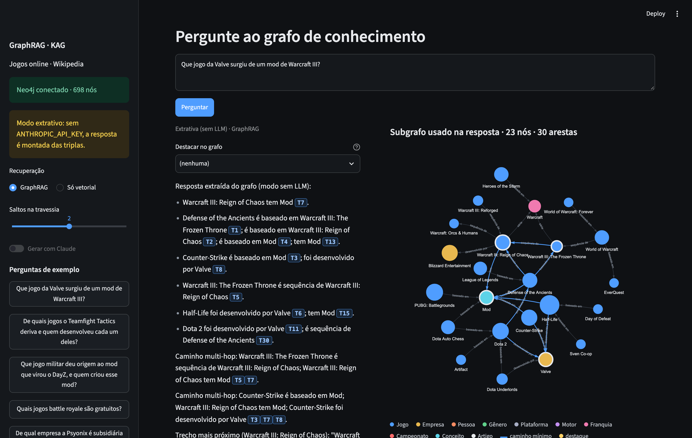

# GraphRAG / KAG — Jogos Online

Projeto final da disciplina **Tendências em Ciência da Computação** (Bacharelado em Ciência da Computação, 2026).

Um assistente de perguntas e respostas sobre **jogos online** que fundamenta cada resposta em um **grafo de conhecimento no Neo4j**, construído automaticamente a partir de 65 artigos da Wikipedia (MOBAs, battle royale, FPS, MMOs, sandbox, mobile e campeonatos de e-sports). O sistema responde perguntas de vários saltos, mostra o subgrafo usado, as consultas Cypher executadas, os nós consultados e um nível de confiança, e se recusa a responder quando a pergunta não toca o grafo.

```
Wikipedia ──► 1. Text-to-Graph ──► 2. Neo4j LPG ──► 3. Recuperação híbrida ──► 4. Interface
 (65 artigos)   NER/RE + resolução    constraints,       vetor + fulltext +        Streamlit +
                de entidades          índices B-tree,    dicionário, multi-hop,    grafo pyvis +
                                      fulltext, vetor,   allShortestPaths,         procedência
                                      PageRank, Louvain  verificador de citações
```

## Requisitos

- Docker (Neo4j 5.26 + plugins GDS e APOC)
- [uv](https://docs.astral.sh/uv/) e Python 3.12
- Opcional: `ANTHROPIC_API_KEY` para gerar respostas e Cypher com o Claude. Sem a chave, o sistema roda em **modo extrativo**: a resposta é montada direto das triplas do grafo.

## Como rodar

```bash
docker compose up -d                      # Neo4j em localhost:7474 (neo4j / graphrag-dev)
cd backend
uv sync                                   # dependências
uv run python -m app.ingest.load --reset  # schema + carga + embeddings + PageRank/Louvain (~1 min)
uv run streamlit run streamlit_app.py     # interface em http://localhost:8501
```

Opcional:

```bash
cp .env.example .env                       # e preencha ANTHROPIC_API_KEY
uv run uvicorn app.api:app --port 8000     # API HTTP (POST /api/ask, GET /api/stats ...)
uv run python -m app.eval.run_eval         # avaliação GraphRAG vs RAG vetorial -> results/
uv run pytest                              # testes (unitários + integração com o Neo4j)
```

Refazer a coleta e a extração do zero (exige chave):

```bash
uv run python -m app.ingest.fetch_wikipedia   # data/raw/articles.json
uv run python -m app.ingest.extract --force   # data/extracted/*.json (Claude, saída JSON com schema)
```

## Resultados

Avaliação do contexto recuperado em 26 perguntas (12 de 1 salto, 9 de 2+ saltos, 5 fora do domínio), contra RAG vetorial puro no mesmo índice (`results/eval.md`):

| Métrica | GraphRAG | RAG vetorial |
|---|---:|---:|
| Perguntas com suporte completo no contexto | 100% | 71,4% |
| Recall no contexto, 2+ saltos | 1,00 | 0,77 |
| Recusa correta fora do domínio | 100% | 0% |
| Latência mediana de recuperação | 320 ms | 14 ms |

As perguntas foram escritas pela equipe a partir do grafo e dois ajustes foram feitos olhando esse mesmo conjunto; leia os números como prova de funcionamento, não como estimativa de generalização (ver seção de limitações do artigo).



## Artigo e slides

- `docs/artigo/artigo.md` é a fonte única do texto. `uv run --project backend --with python-docx==1.1.2 python docs/artigo/build.py` gera `artigo.tex` (modelo SBC) e `artigo.docx`.
- `artigo.pdf` já vem compilado (pdfLaTeX + BibTeX, TeX Live 2026). Para recompilar: envie `artigo.tex`, `referencias.bib`, `sbc-template.sty` e a pasta `img/` ao Overleaf (pdfLaTeX + BibTeX). O `sbc-template.sty` incluído é uma reimplementação compatível; para submissão oficial troque pelo `sbc-template.sty` e `sbc.bst` do pacote da SBC.
- `docs/slides/defesa-graphrag-jogos.pptx` (e `.pdf`): slides da defesa, 14 slides com notas do apresentador. Gerados por `docs/slides/build.js` (pptxgenjs 3.12).

## Estrutura

| Caminho | Papel |
|---|---|
| `backend/app/ingest/fetch_wikipedia.py` | Coleta a introdução de 65 artigos pela API MediaWiki |
| `backend/app/ingest/extract.py` | NER/RE com Claude: schema Pydantic, prompt e descarte de relações sem evidência literal |
| `backend/app/ingest/resolve.py` | Resolução de entidades: chave lexical, siglas, aliases compatíveis, embeddings com trava lexical e de versão |
| `backend/app/ingest/load.py` | Carga no Neo4j, embeddings, PageRank e Louvain (GDS) |
| `backend/app/schema.py` | Constraints de unicidade, índices range (B-tree), fulltext e vetoriais |
| `backend/app/retrieval/hybrid.py` | Busca híbrida, travessia multi-hop, allShortestPaths, reordenação |
| `backend/app/retrieval/text2cypher.py` | Geração de Cypher pelo LLM com trava de somente leitura |
| `backend/app/generate.py` | Resposta ancorada em triplas, verificador de citações, confiança |
| `backend/app/pipeline.py` | Pipeline usado pela interface e pela API |
| `backend/streamlit_app.py` | Interface: resposta, subgrafo interativo, triplas, Cypher, nós, trechos, avaliação |
| `backend/app/eval/` | Perguntas com gabarito e script de avaliação |
| `data/` | Artigos brutos e extrações versionados (reprodutibilidade) |
| `docs/` | Artigo (LaTeX SBC e .docx) e slides da defesa |

## Modelo do grafo (LPG)

- `(:Article {doc_id, title, text, url})-[:DESCRIBES]->(:Entity)`
- `(:Chunk {id, text})-[:PART_OF]->(:Article)`
- `(:Entity)` com rótulo de tipo `:Game | :Company | :Person | :Genre | :Platform | :Engine | :Franchise | :Event | :Concept`
- Relações entre entidades, cada uma com `evidence` (frase literal do artigo) e `doc_id`: `DEVELOPED_BY`, `PUBLISHED_BY`, `HAS_GENRE`, `AVAILABLE_ON`, `USES_ENGINE`, `PART_OF`, `SEQUEL_OF`, `BASED_ON`, `HAS_FEATURE`, `FEATURED_IN`, `SUBSIDIARY_OF`, `CREATED_BY`, `ORGANIZED_BY`

## Mitigação de alucinações

1. **Na ingestão:** relação sem evidência literal no texto é descartada.
2. **Na recuperação:** só entram no contexto triplas do grafo e trechos dos artigos; perguntas sem entidade reconhecida e com similaridade baixa são recusadas ("Não encontrei essa informação no grafo").
3. **Na geração:** o LLM cita `[T#]`/`[C#]` em cada afirmação; um verificador remove citações inexistentes e conta frases sem apoio, o que entra no nível de confiança.
4. **No Cypher gerado:** filtro de cláusulas de escrita e execução em transação de leitura.

## Créditos e bibliotecas

Neo4j + Graph Data Science, Anthropic SDK (Claude), sentence-transformers (`intfloat/multilingual-e5-small`), Streamlit, pyvis (vis-network), FastAPI, Pydantic. Textos: Wikipedia (CC BY-SA 4.0), introduções dos artigos listados em `data/raw/articles.json`.

A extração de entidades e relações versionada em `data/extracted/` foi gerada com Claude seguindo exatamente o prompt e o schema de `app/ingest/extract.py`, e validada automaticamente: toda relação tem evidência literal no texto.
